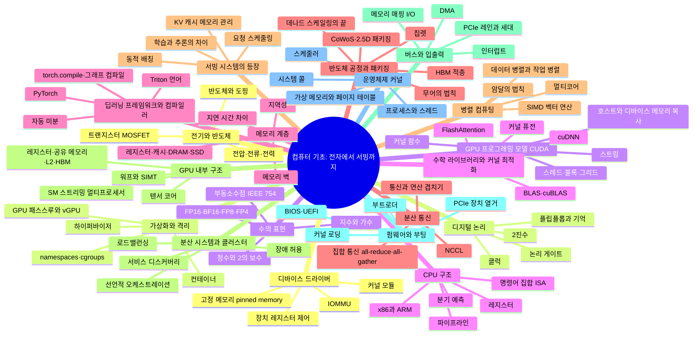

# 00. 컴퓨터 기초: 전자에서 서빙까지

전기 신호 하나에서 출발해 LLM 서빙 시스템까지, 각 층이 아래 층의 어떤 한계 때문에 생겨났는지 순서대로 잇는 척추 가지

[전체 지도로 돌아가기](../README.md)

## 세부 마인드맵

## 주제

| 주제 | 키워드 |
|---|---|
| [전기와 반도체](./01-electricity-semiconductor.md) | 전압·전류·전력, 반도체와 도핑, 트랜지스터 MOSFET |
| [디지털 논리](./02-digital-logic.md) | 2진수, 논리 게이트, 플립플롭과 기억, 클럭 |
| [수의 표현](./03-number-representation.md) | 정수와 2의 보수, 부동소수점 IEEE 754, 지수와 가수, FP16·BF16·FP8·FP4 |
| [CPU 구조](./04-cpu-architecture.md) | 명령어 집합 ISA, 레지스터, 파이프라인, 분기 예측, x86과 ARM |
| [메모리 계층](./05-memory-hierarchy.md) | 레지스터·캐시·DRAM·SSD, 지연 시간 차이, 지역성, 메모리 벽 |
| [반도체 공정과 패키징](./06-scaling-packaging.md) | 무어의 법칙, 데나드 스케일링의 끝, 칩렛, CoWoS·2.5D 패키징, HBM 적층 |
| [병렬 컴퓨팅](./07-parallel-computing.md) | 멀티코어, SIMD 벡터 연산, 암달의 법칙, 데이터 병렬과 작업 병렬 |
| [GPU 내부 구조](./08-gpu-internals.md) | SM 스트리밍 멀티프로세서, 워프와 SIMT, 레지스터·공유 메모리·L2·HBM, 텐서 코어 |
| [버스와 입출력](./09-bus-io.md) | PCIe 레인과 세대, DMA, 인터럽트, 메모리 매핑 I/O |
| [펌웨어와 부팅](./10-firmware-boot.md) | BIOS·UEFI, PCIe 장치 열거, 부트로더, 커널 로딩 |
| [운영체제 커널](./11-os-kernel.md) | 프로세스와 스레드, 가상 메모리와 페이지 테이블, 시스템 콜, 스케줄러 |
| [디바이스 드라이버](./12-device-drivers.md) | 커널 모듈, 장치 레지스터 제어, IOMMU, 고정 메모리 pinned memory |
| [가상화와 격리](./13-virtualization-isolation.md) | 하이퍼바이저, namespaces·cgroups, 컨테이너, GPU 패스스루와 vGPU |
| [GPU 프로그래밍 모델 CUDA](./14-gpu-programming-model.md) | 커널 함수, 스레드·블록·그리드, 호스트와 디바이스 메모리 복사, 스트림 |
| [수학 라이브러리와 커널 최적화](./15-math-libraries-kernels.md) | BLAS·cuBLAS, cuDNN, FlashAttention, 커널 퓨전 |
| [딥러닝 프레임워크와 컴파일러](./16-frameworks-compilers.md) | PyTorch, 자동 미분, torch.compile·그래프 컴파일, Triton 언어 |
| [분산 통신](./17-collective-communication.md) | 집합 통신 all-reduce·all-gather, NCCL, 통신과 연산 겹치기 |
| [서빙 시스템의 등장](./18-serving-systems.md) | 요청 스케줄링, 동적 배칭, KV 캐시 메모리 관리, 학습과 추론의 차이 |
| [분산 시스템과 클러스터](./19-distributed-systems.md) | 서비스 디스커버리, 로드밸런싱, 장애 허용, 선언적 오케스트레이션 |
