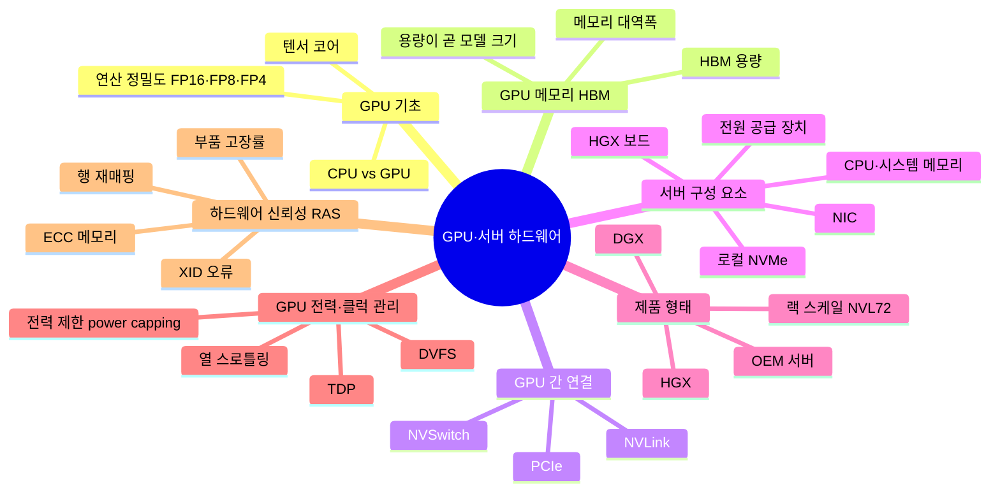

# 01. GPU·서버 하드웨어

LLM을 실제로 계산하는 GPU와, 그 GPU를 담는 서버의 구성 요소

[전체 지도로 돌아가기](../README.md)

## 세부 마인드맵

## 주제

| 주제 | 키워드 |
|---|---|
| [GPU 기초](./01-gpu-basics.md) | CPU vs GPU, 텐서 코어, 연산 정밀도 FP16·FP8·FP4 |
| [GPU 메모리 HBM](./02-gpu-memory.md) | HBM 용량, 메모리 대역폭, 용량이 곧 모델 크기 |
| [GPU 간 연결](./03-gpu-interconnect.md) | PCIe, NVLink, NVSwitch |
| [서버 구성 요소](./04-server-components.md) | HGX 보드, CPU·시스템 메모리, NIC, 로컬 NVMe, 전원 공급 장치 |
| [제품 형태](./05-form-factors.md) | HGX, DGX, 랙 스케일 NVL72, OEM 서버 |
| [GPU 전력·클럭 관리](./06-power-thermal-management.md) | TDP, 전력 제한 power capping, DVFS, 열 스로틀링 |
| [하드웨어 신뢰성 RAS](./07-reliability-ras.md) | ECC 메모리, XID 오류, 행 재매핑, 부품 고장률 |
