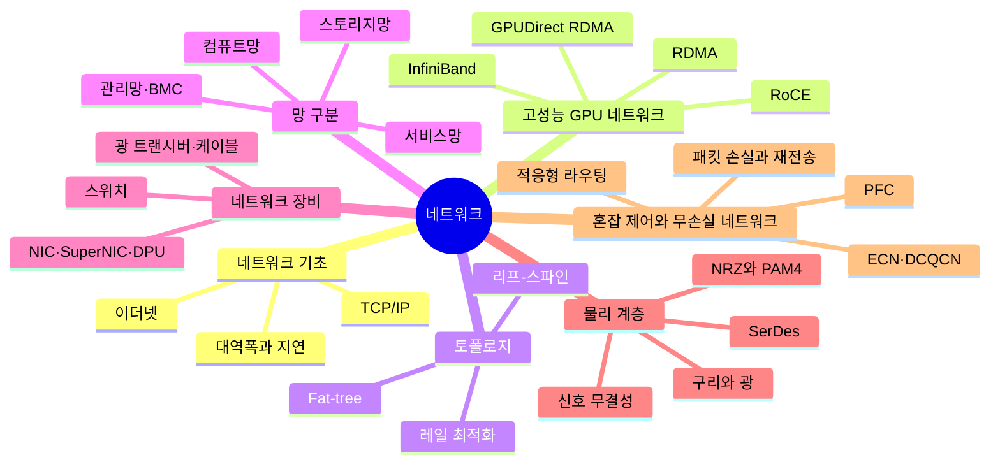

# 02. 네트워크

GPU 서버끼리, 그리고 사용자·스토리지와 데이터를 주고받는 길

[전체 지도로 돌아가기](../README.md)

## 세부 마인드맵

## 주제

| 주제 | 키워드 |
|---|---|
| [네트워크 기초](./01-network-basics.md) | 이더넷, TCP/IP, 대역폭과 지연 |
| [고성능 GPU 네트워크](./02-rdma-fabrics.md) | RDMA, InfiniBand, RoCE, GPUDirect RDMA |
| [토폴로지](./03-topology.md) | 리프-스파인, Fat-tree, 레일 최적화 |
| [망 구분](./04-network-segmentation.md) | 컴퓨트망, 스토리지망, 관리망·BMC, 서비스망 |
| [네트워크 장비](./05-network-hardware.md) | 스위치, NIC·SuperNIC·DPU, 광 트랜시버·케이블 |
| [물리 계층](./06-physical-layer.md) | SerDes, NRZ와 PAM4, 구리와 광, 신호 무결성 |
| [혼잡 제어와 무손실 네트워크](./07-congestion-lossless.md) | 패킷 손실과 재전송, PFC, ECN·DCQCN, 적응형 라우팅 |
