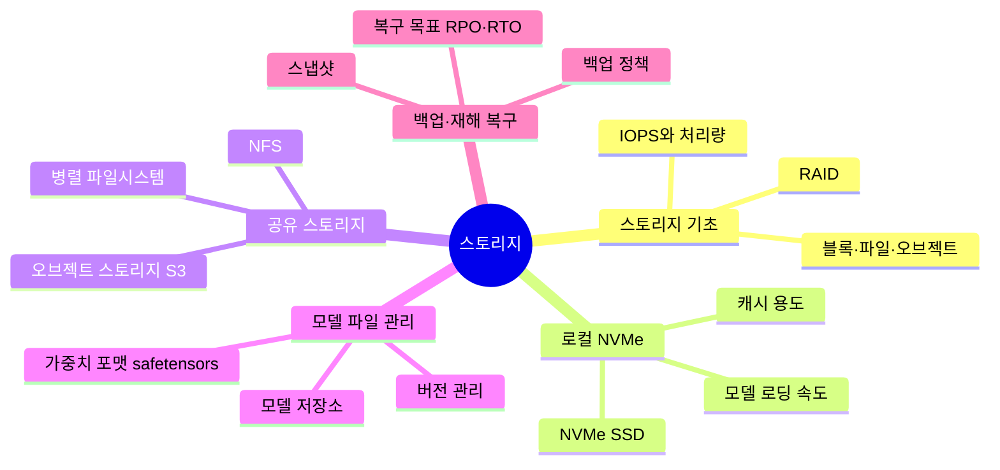

# 03. 스토리지

모델 가중치와 데이터를 저장하고 GPU 서버로 빠르게 가져오는 방법

[전체 지도로 돌아가기](../README.md)

## 세부 마인드맵

## 주제

| 주제 | 키워드 |
|---|---|
| [스토리지 기초](./01-storage-basics.md) | 블록·파일·오브젝트, IOPS와 처리량, RAID |
| [로컬 NVMe](./02-local-nvme.md) | NVMe SSD, 모델 로딩 속도, 캐시 용도 |
| [공유 스토리지](./03-shared-storage.md) | NFS, 병렬 파일시스템, 오브젝트 스토리지 S3 |
| [모델 파일 관리](./04-model-artifact-management.md) | 가중치 포맷 safetensors, 모델 저장소, 버전 관리 |
| [백업·재해 복구](./05-backup-dr.md) | 백업 정책, 스냅샷, 복구 목표 RPO·RTO |
