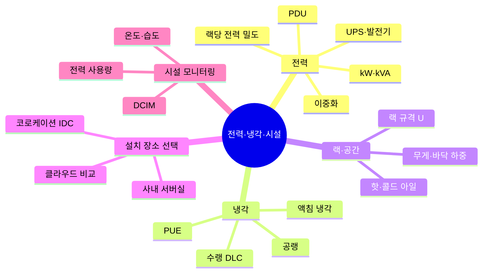

# 04. 전력·냉각·시설

GPU 서버가 안정적으로 돌아가도록 전기와 열, 공간을 감당하는 물리 인프라

[전체 지도로 돌아가기](../README.md)

## 세부 마인드맵

## 주제

| 주제 | 키워드 |
|---|---|
| [전력](./01-power.md) | kW·kVA, 랙당 전력 밀도, PDU, UPS·발전기, 이중화 |
| [냉각](./02-cooling.md) | 공랭, 수랭 DLC, 액침 냉각, PUE |
| [랙·공간](./03-rack-space.md) | 랙 규격 U, 무게·바닥 하중, 핫·콜드 아일 |
| [설치 장소 선택](./04-site-options.md) | 사내 서버실, 코로케이션 IDC, 클라우드 비교 |
| [시설 모니터링](./05-facility-monitoring.md) | 온도·습도, 전력 사용량, DCIM |
