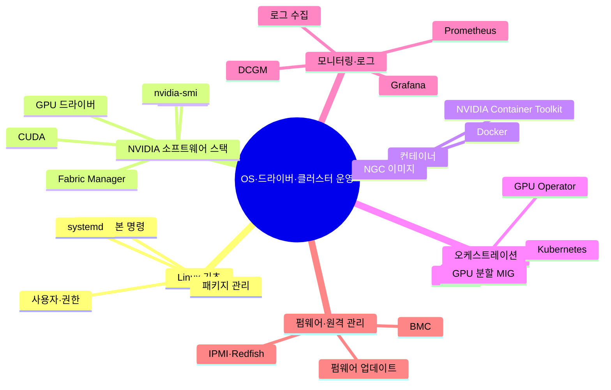

# 05. OS·드라이버·클러스터 운영

하드웨어 위에서 GPU를 쓸 수 있게 만드는 소프트웨어 기반

[전체 지도로 돌아가기](../README.md)

## 세부 마인드맵

## 주제

| 주제 | 키워드 |
|---|---|
| [Linux 기초](./01-linux-basics.md) | 셸과 기본 명령, 패키지 관리, systemd, 사용자·권한 |
| [NVIDIA 소프트웨어 스택](./02-nvidia-stack.md) | GPU 드라이버, CUDA, NCCL, Fabric Manager, nvidia-smi |
| [컨테이너](./03-containers.md) | Docker, NVIDIA Container Toolkit, NGC 이미지 |
| [오케스트레이션](./04-orchestration.md) | Kubernetes, GPU Operator, Slurm, GPU 분할 MIG |
| [모니터링·로그](./05-observability.md) | DCGM, Prometheus, Grafana, 로그 수집 |
| [펌웨어·원격 관리](./06-firmware-bmc.md) | BMC, IPMI·Redfish, 펌웨어 업데이트 |
