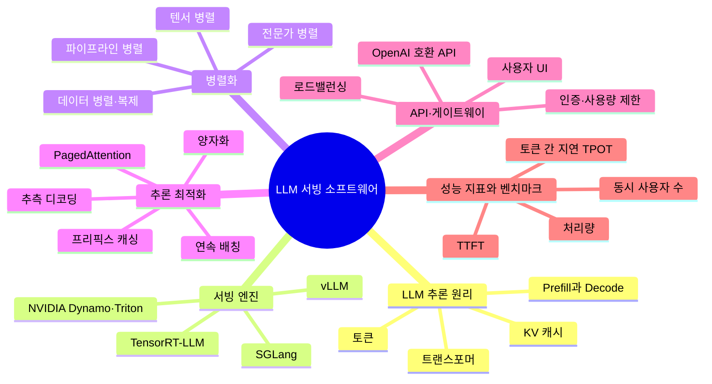

# 06. LLM 서빙 소프트웨어

모델을 GPU에 올려 사내 사용자의 요청에 빠르고 효율적으로 답하게 하는 기술

[전체 지도로 돌아가기](../README.md)

## 세부 마인드맵

## 주제

| 주제 | 키워드 |
|---|---|
| [LLM 추론 원리](./01-llm-inference-basics.md) | 토큰, 트랜스포머, Prefill과 Decode, KV 캐시 |
| [서빙 엔진](./02-serving-engines.md) | vLLM, SGLang, TensorRT-LLM, NVIDIA Dynamo·Triton |
| [병렬화](./03-parallelism.md) | 텐서 병렬, 파이프라인 병렬, 전문가 병렬, 데이터 병렬·복제 |
| [추론 최적화](./04-optimization.md) | 양자화, 연속 배칭, PagedAttention, 프리픽스 캐싱, 추측 디코딩 |
| [API·게이트웨이](./05-api-gateway.md) | OpenAI 호환 API, 인증·사용량 제한, 로드밸런싱, 사용자 UI |
| [성능 지표와 벤치마크](./06-performance-metrics.md) | TTFT, 토큰 간 지연 TPOT, 처리량, 동시 사용자 수 |
