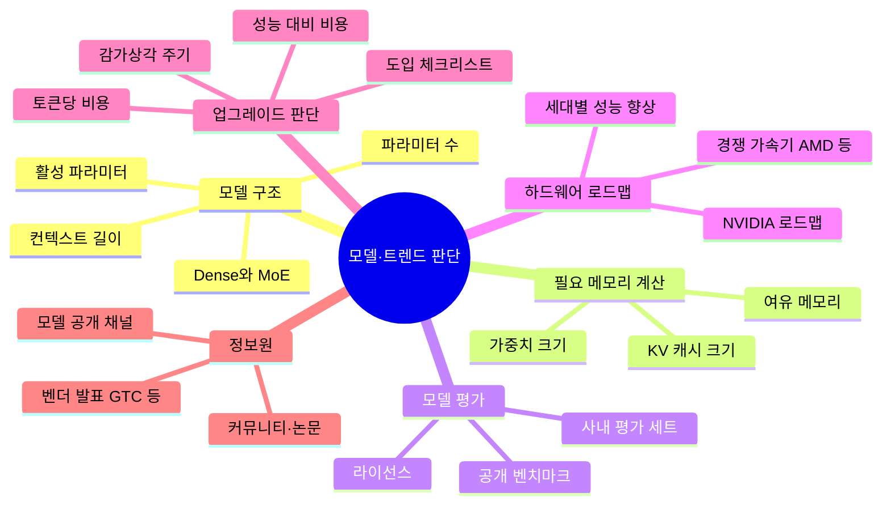

# 07. 모델·트렌드 판단

새 모델과 새 하드웨어가 나올 때 도입과 업그레이드를 판단하는 기준

[전체 지도로 돌아가기](../README.md)

## 세부 마인드맵

## 주제

| 주제 | 키워드 |
|---|---|
| [모델 구조](./01-model-architecture.md) | Dense와 MoE, 파라미터 수, 활성 파라미터, 컨텍스트 길이 |
| [필요 메모리 계산](./02-memory-sizing.md) | 가중치 크기, KV 캐시 크기, 여유 메모리 |
| [모델 평가](./03-model-evaluation.md) | 공개 벤치마크, 사내 평가 세트, 라이선스 |
| [하드웨어 로드맵](./04-hardware-roadmap.md) | NVIDIA 로드맵, 경쟁 가속기 AMD 등, 세대별 성능 향상 |
| [업그레이드 판단](./05-upgrade-decision.md) | 토큰당 비용, 성능 대비 비용, 감가상각 주기, 도입 체크리스트 |
| [정보원](./06-information-sources.md) | 모델 공개 채널, 벤더 발표 GTC 등, 커뮤니티·논문 |
