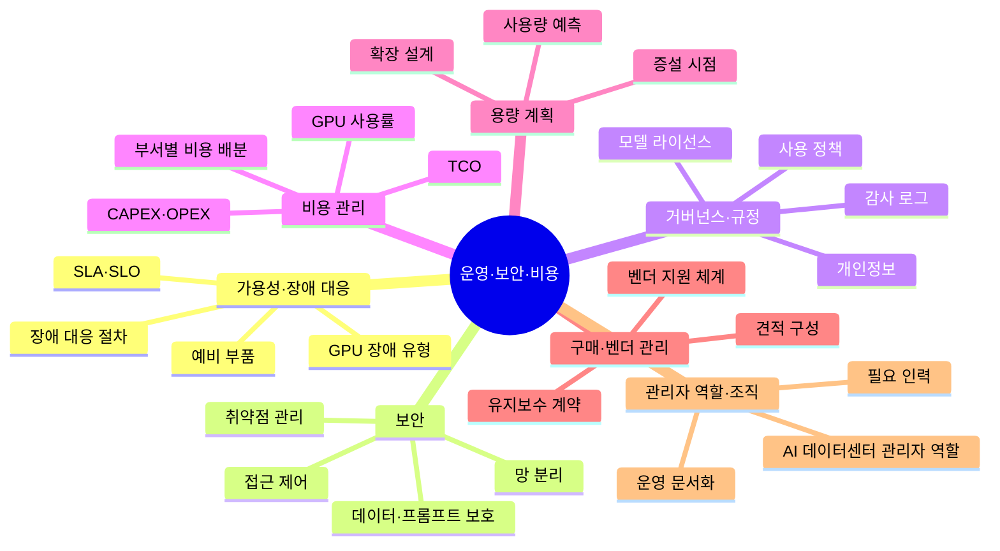

# 08. 운영·보안·비용

AI 데이터센터 관리자가 책임지는 안정성, 보안, 돈, 조직

[전체 지도로 돌아가기](../README.md)

## 세부 마인드맵

## 주제

| 주제 | 키워드 |
|---|---|
| [가용성·장애 대응](./01-reliability.md) | SLA·SLO, 장애 대응 절차, GPU 장애 유형, 예비 부품 |
| [보안](./02-security.md) | 접근 제어, 망 분리, 데이터·프롬프트 보호, 취약점 관리 |
| [거버넌스·규정](./03-governance.md) | 개인정보, 모델 라이선스, 사용 정책, 감사 로그 |
| [비용 관리](./04-cost-management.md) | CAPEX·OPEX, TCO, GPU 사용률, 부서별 비용 배분 |
| [용량 계획](./05-capacity-planning.md) | 사용량 예측, 증설 시점, 확장 설계 |
| [구매·벤더 관리](./06-procurement-vendor.md) | 견적 구성, 유지보수 계약, 벤더 지원 체계 |
| [관리자 역할·조직](./07-role-and-team.md) | AI 데이터센터 관리자 역할, 필요 인력, 운영 문서화 |
