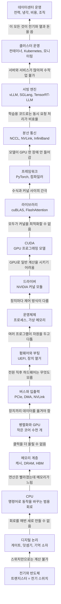

# 연결 체인: 전기 신호에서 LLM 서빙까지

[전체 지도로 돌아가기](./README.md)

컴퓨터의 모든 층은 "아래 층만으로는 해결할 수 없는 문제"가 생겼기 때문에 만들어졌습니다. 이 문서는 그 인과 관계를 한 줄기로 이어 둔 것입니다. 각 층을 공부할 때 항상 두 가지를 물어보세요.

1. 이 층은 **아래 층의 어떤 한계**를 해결하려고 생겼나?
2. 이 층이 생기면서 **어떤 새로운 한계**가 생겼고, 그것이 다음 층을 어떻게 불렀나?

## 한눈에 보기

## 층별 정리

| # | 층 | 해결한 문제 | 남긴 한계 → 다음 층 | 기초 노트 | 심화 가지 |
|---|---|---|---|---|---|
| 1 | 전기와 반도체 | 작고 빠르고 전력을 덜 쓰는 스위치 | 스위치는 켜고 끄기만 한다 | [01](./00-foundations/01-electricity-semiconductor.md) | [04 시설·전력](./04-facility/README.md) |
| 2 | 디지털 논리 | 스위치 조합으로 계산과 기억 | 문제마다 회로를 새로 만들어야 한다 | [02](./00-foundations/02-digital-logic.md) | |
| 3 | 수의 표현 | 유한한 비트로 정수와 실수 표현 | 비트가 적을수록 빠르지만 부정확하다 | [03](./00-foundations/03-number-representation.md) | [06 서빙·양자화](./06-serving/04-optimization.md) |
| 4 | CPU | 명령어로 같은 회로가 여러 일을 한다 | 메모리가 연산 속도를 못 따라온다 | [04](./00-foundations/04-cpu-architecture.md) | [01 하드웨어](./01-hardware/README.md) |
| 5 | 메모리 계층 | 자주 쓰는 데이터를 가까이 두어 지연을 숨김 | 데이터를 옮기는 것 자체가 병목이 된다 | [05](./00-foundations/05-memory-hierarchy.md) | [01 GPU 메모리](./01-hardware/02-gpu-memory.md) |
| 6 | 공정과 패키징 | 더 많은 트랜지스터, 칩과 메모리를 가깝게 | 전력 밀도 때문에 클럭을 못 올린다 | [06](./00-foundations/06-scaling-packaging.md) | [01 전력·클럭 관리](./01-hardware/06-power-thermal-management.md) |
| 7 | 병렬 컴퓨팅과 GPU | 단순 연산을 대량으로 동시에 | 장치가 늘어나 서로 데이터를 옮겨야 한다 | [07](./00-foundations/07-parallel-computing.md), [08](./00-foundations/08-gpu-internals.md) | [01 GPU 기초](./01-hardware/01-gpu-basics.md) |
| 8 | 버스와 입출력 | CPU 개입 없이 장치 간 데이터 이동 | 장치를 찾고 초기화할 주체가 필요하다 | [09](./00-foundations/09-bus-io.md) | [01 GPU 간 연결](./01-hardware/03-gpu-interconnect.md) |
| 9 | 펌웨어와 부팅 | 하드웨어를 OS가 쓸 수 있는 상태로 | 여러 프로그램이 동시에 쓰면 충돌한다 | [10](./00-foundations/10-firmware-boot.md) | [05 펌웨어·BMC](./05-platform/06-firmware-bmc.md) |
| 10 | 운영체제 | 자원을 안전하게 나눠 줌 | 장치마다 제어 방식이 다르다 | [11](./00-foundations/11-os-kernel.md) | [05 Linux 기초](./05-platform/01-linux-basics.md) |
| 11 | 드라이버 | 장치 차이를 표준 인터페이스로 감춤 | GPU로 일반 계산을 시키기 어렵다 | [12](./00-foundations/12-device-drivers.md) | [05 NVIDIA 스택](./05-platform/02-nvidia-stack.md) |
| 12 | 가상화와 격리 | 여러 사용자·버전이 간섭 없이 공존 | 격리된 환경이 많아져 관리가 복잡해진다 | [13](./00-foundations/13-virtualization-isolation.md) | [05 컨테이너](./05-platform/03-containers.md) |
| 13 | CUDA | GPU에 범용 계산을 맡김 | 최적의 커널을 짜기가 매우 어렵다 | [14](./00-foundations/14-gpu-programming-model.md) | |
| 14 | 수학 라이브러리 | 최적화된 연산을 부품처럼 재사용 | 수식에서 커널까지 수작업 연결이 번거롭다 | [15](./00-foundations/15-math-libraries-kernels.md) | |
| 15 | 프레임워크·컴파일러 | 수식을 자동으로 GPU 연산으로 | 모델이 GPU 한 장보다 커진다 | [16](./00-foundations/16-frameworks-compilers.md) | |
| 16 | 분산 통신 | 여러 GPU가 한 모델을 함께 계산 | 통신 속도가 네트워크 설계를 좌우한다 | [17](./00-foundations/17-collective-communication.md) | [02 네트워크](./02-network/README.md), [06 병렬화](./06-serving/03-parallelism.md) |
| 17 | 서빙 엔진 | 제각각인 요청을 묶어 GPU를 쉬지 않게 | 서버와 서비스 수가 늘어난다 | [18](./00-foundations/18-serving-systems.md) | [06 서빙](./06-serving/README.md) |
| 18 | 클러스터 운영 | 배포, 복구, 확장을 자동으로 | 전력, 냉각, 비용, 보안, 사람의 문제가 남는다 | [19](./00-foundations/19-distributed-systems.md) | [05 플랫폼](./05-platform/README.md) |
| 19 | 데이터센터 운영 | 물리 자원과 돈과 조직을 지속 가능하게 | 새 모델과 새 하드웨어가 계속 나온다 | | [04 시설](./04-facility/README.md), [07 트렌드](./07-models-trends/README.md), [08 운영](./08-operations/README.md) |

## 세 가지 반복되는 패턴

공부하다 보면 같은 패턴이 층마다 되풀이됩니다. 이 세 가지를 의식하면 새로운 기술을 봐도 "어느 패턴의 반복인지" 바로 보입니다.

- **데이터 이동이 계산보다 비싸다.** 캐시, HBM, NVLink, FlashAttention, KV 캐시 관리, InfiniBand가 모두 "데이터를 덜 옮기거나 더 빨리 옮기는" 기술입니다.
- **복잡함을 감추는 층이 생긴다.** 드라이버, OS, CUDA, 라이브러리, 프레임워크, Kubernetes는 모두 아래 층의 세부 사항을 감추고 표준 인터페이스를 제공합니다. 대신 문제가 생기면 여러 층을 뚫고 내려가야 원인이 보입니다.
- **하나로 안 되면 나누고, 나누면 조율이 필요하다.** 코어 하나 → 멀티코어 → GPU → 여러 GPU → 여러 서버로 나눌 때마다 통신과 조율이 새로운 병목이 됩니다.
