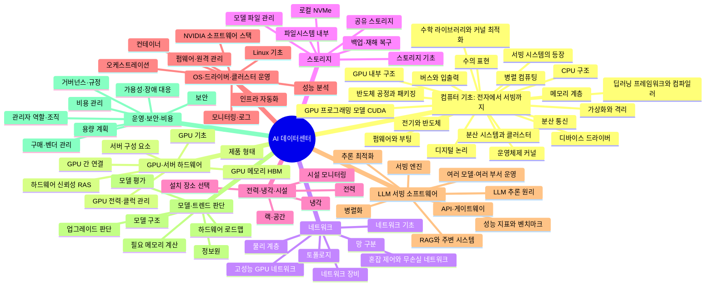

# AIKnowledge

AI 데이터센터 전체를 혼자 설계하고 운영할 수 있는 수준까지 공부하기 위한 지식 지도입니다.

> 처음이라면 [CHAIN.md](./CHAIN.md)부터 읽으세요. 전기 신호 하나에서 LLM 서빙까지, 각 층이 아래 층의 어떤 한계 때문에 생겨났는지 한 줄기로 이어 둔 문서입니다.
> 우리 장비의 실제 숫자는 [B300.md](./B300.md)에 모아 두었습니다. 각 노트의 "B300 서버와의 연결" 칸이 이 숫자를 근거로 합니다.

## 전체 마인드맵

## 큰 가지

| 번호 | 가지 | 다루는 내용 |
|---|---|---|
| 00 | [컴퓨터 기초: 전자에서 서빙까지](./00-foundations/README.md) | 전기 신호 하나에서 출발해 LLM 서빙 시스템까지, 각 층이 아래 층의 어떤 한계 때문에 생겨났는지 순서대로 잇는 척추 가지 |
| 01 | [GPU·서버 하드웨어](./01-hardware/README.md) | LLM을 실제로 계산하는 GPU와, 그 GPU를 담는 서버의 구성 요소 |
| 02 | [네트워크](./02-network/README.md) | GPU 서버끼리, 그리고 사용자·스토리지와 데이터를 주고받는 길 |
| 03 | [스토리지](./03-storage/README.md) | 모델 가중치와 데이터를 저장하고 GPU 서버로 빠르게 가져오는 방법 |
| 04 | [전력·냉각·시설](./04-facility/README.md) | GPU 서버가 안정적으로 돌아가도록 전기와 열, 공간을 감당하는 물리 인프라 |
| 05 | [OS·드라이버·클러스터 운영](./05-platform/README.md) | 하드웨어 위에서 GPU를 쓸 수 있게 만드는 소프트웨어 기반 |
| 06 | [LLM 서빙 소프트웨어](./06-serving/README.md) | 모델을 GPU에 올려 사내 사용자의 요청에 빠르고 효율적으로 답하게 하는 기술 |
| 07 | [모델·트렌드 판단](./07-models-trends/README.md) | 새 모델과 새 하드웨어가 나올 때 도입과 업그레이드를 판단하는 기준 |
| 08 | [운영·보안·비용](./08-operations/README.md) | AI 데이터센터 관리자가 책임지는 안정성, 보안, 돈, 조직 |

## 사용 방법

- 각 폴더의 `README.md`에 그 가지의 세부 마인드맵과 주제 목록이 있습니다.
- 주제별 노트 파일에는 제목과 "공부할 질문"만 들어 있습니다. 공부하면서 요약, 핵심 개념, 참고 자료를 직접 채워 나갑니다.
- 각 노트의 "왜 필요해졌나"에는 그 주제가 아래 층의 어떤 한계 때문에 생겼는지 한두 문장으로 적혀 있습니다. 공부하면서 내 말로 다시 써 보세요.
- 질문에 답할 수 있게 되면 체크박스를 체크합니다.

## 추천 순서

1. `00` 컴퓨터 기초를 01번부터 순서대로. 이것이 나머지 모든 가지의 뿌리입니다.
2. `01` 하드웨어 → `02` 네트워크 → `03` 스토리지 → `04` 시설: 물리 인프라
3. `05` 플랫폼 → `06` 서빙: 소프트웨어 스택
4. `07` 트렌드 판단 → `08` 운영: 관리자로서의 판단

## 진행 계획

1. 전체 지도와 폴더 뼈대, 로우 레벨 연결 체인
2. B300 서버 사양 정리와 노트별 연결
3. 모델·트렌드 판단 가지 보강, 사내 견적 문서 연결
